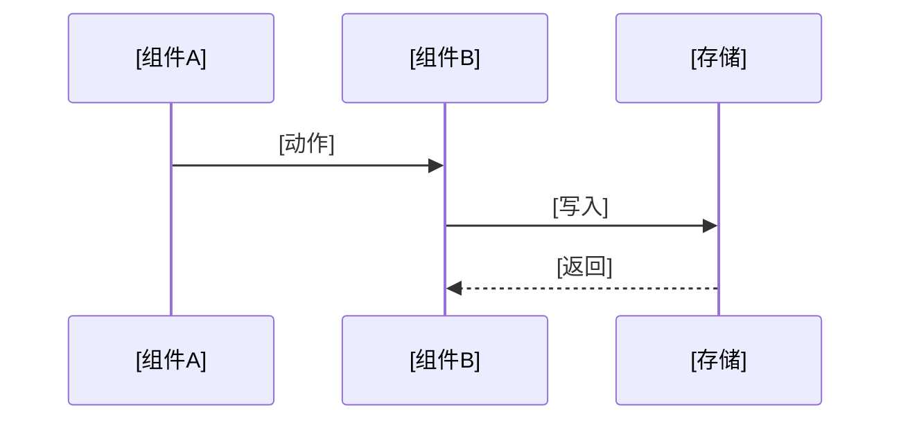

# 正文模板（方向 A · Agent 类系统 私有层）

**使用前提**：仅在阶段三「范围冻结」获得明确确认、且特化方向判为 A 后使用。在此之前禁止输出本模板内容。

**引用关系**（禁止复制以下内容到本文件）：

| 内容 | 引用位置 |
| :--- | :--- |
| 占位符双轨制、语言、编号体例、排版规则 R1–R11、正文净化机制 | `../shared/conventions.md` |
| 通用门禁 G1–G10 | `../shared/quality-gate.md` |
| **补充说明文档六节结构** | `../shared/companion-doc.md` |
| 指标表结构与三层分层 | `../shared/metrics-spec.md` |
| 异常五分类与降级策略表 | `../shared/exception-handling.md` |
| 能力规约细则、输出双向约束、MCP 状态、模型依赖、知识源 | `capability-spec.md` |

**标注约定**：【必选】不可缺省；【按需】不涉及则整节省略并注明「本章节不涉及，原因：[原因]」，禁止留空表。

**正文净化约束（强制）**

(1) 本模板为**正文**。首行为文档标题，其后直接进入第一章，**不写元信息行**。

(2) 正文**不得出现**：版本号、日期、作者、名词解释、角色与读者、需求背景、痛点、目标用户、需求目标、成功标准、待确认清单、篇幅说明、配套索引。

(3) 缺失信息按 `../shared/conventions.md` §1.1 三选一处理：中性表述（「以配置提供」「由部署配置提供」「按 X 约定」「按 X 确定」）或省略；**不得**出现 `[待补充：…]`、`待定`、`TBD`、`—`。

(4) 每一处中性表述与省略项，须同步登记到补充说明 §3.3「正文留空位置对照」。

---

# [产品 / 系统名称] 产品需求文档（PRD）

## 一、范围与边界

### 1.1 本期能力清单 【必选】

| 能力 | 场景 ID | 职责（做什么） | 边界（明确禁止） | 触发方式 | 优先级 |
| :--- | :--- | :--- | :--- | :--- | :--- |
| [能力名] | `Scene_[业务域]_[场景名]` | [该系统在该能力下**必须**完成的事] | [该系统在该能力下**绝对不做**的事] | 定时 / 事件驱动 / 用户主动 / 随写入 | P0 |

**「边界」列是强制列。** 写不满就说明该能力的需求尚未想清。示例口径：`不做自定义脚本` / `不做日志全文检索` / `不做判定时直连设备取数`。

### 1.2 明确不做（本期排除项）【必选】

| 类别 | 排除项 |
| :--- | :--- |
| [分析增强 / 采集扩展 / 交付形态 / 集成 / 与约束冲突 …] | [排除项列表] |

与 1.1 边界列区分：**边界列是「永久不做」，本表是「本期不做」**。排除理由、依赖与立项建议写入补充说明 §5。

### 1.3 硬约束 【必选】

编号 `C1…Cn`，全文引用。约束是本类项目的最高优先级规则，任何需求变更不得与之冲突。

| 编号 | 名称 | 内容 |
| :--- | :--- | :--- |
| C1 | [约束名] | [不可违背的规则原文] |

常见约束类型（逐类检查是否适用）：

1. 动作权限边界（只读 / 可写 / 可执行命令）
2. 数据流向边界（出网、脱敏、白名单）
3. 主链路不可阻断
4. 平台兼容矩阵
5. 取值纪律（规范未给出数值的项以配置提供，禁止以示例值或经验值填充）
6. 扩展方式（插拔、配置化）
7. 部署形态（单机 / 云 / 边缘）
8. 人工确认红线

### 1.4 参数基线 【必选】

全文所有可调数值集中于此表，正文其他位置**不再重复列**（`../shared/conventions.md` R7）。

| 项 | 值 | 项 | 值 |
| :--- | :--- | :--- | :--- |
| [参数名] | [默认值（可配范围）] | [参数名] | [默认值（可配范围）] |

### 1.5 环境与兼容性矩阵 【按需】

| 维度 | 覆盖范围 | 说明 |
| :--- | :--- | :--- |
| 操作系统 | [列表] | [各平台差异点]；最低支持版本按部署环境确定 |
| CPU 架构 | [列表] | [各架构差异点] |
| 运行时 / 依赖版本 | [列表] | [版本下限与已知不兼容项] |
| 网络环境 | [NAT / 防火墙 / 专线 / 断网] | [通信方式与降级] |
| 部署形态 | [单机 / 集群 / 云 / 边缘] | [本期落地形态] |
| 主机规格 | [中心与应用主机的规格要求] | 按部署环境确定 |

---

## 二、能力规约 【必选 · 核心章节】

按 2.x 重复，**每个能力一节，节内 8 个小节全部必选**。能力划分原则与各小节细则见 `capability-spec.md`。

### 2.1 能力一：[能力名称]

#### 2.1.1 场景描述 【必选】

100–200 字，含问题、Agent 角色、核心价值三要素。禁止「高效」「便捷」「智能」等表述。

#### 2.1.2 场景基本信息 【必选】

| 项目 | 内容 |
| :--- | :--- |
| 场景 ID | `Scene_[业务域]_[场景名]` |
| 触发方式 | 用户主动 / 定时 / 事件驱动 / API 调用 / 混合 |
| 触发频率 | [频率及可配范围] |
| 输入形式 | 自然语言 / 结构化数据 / 文件 / 多模态 / 系统事件 |
| 输出形式 | 信息查询结果 / 动作执行 / 内容生成 / 无输出（仅落库） |
| 执行主体 | [Agent 侧 / 中心侧 / 协同] |
| 核心痛点 | [① …② …] |
| 业务价值 | [① …② …，必须可量化] |
| 优先级 | P0 / P1 / P2 + 理由 |

#### 2.1.3 运行流程 【必选】

含开始节点、触发源、核心处理、分支路径、**异常路径**、结束节点，使用 Mermaid。

存在**多阶段流程**时，按「触发 → 采集 / 取数 → 判定 → 处理 → 输出 → 落库」分阶段画，不要把所有节点塞进一张图。

```mermaid
flowchart TD
    A([开始]) --> B[触发源：[触发方式]]
    B --> C[取数 / 采集]
    C --> D{数据是否就绪}
    D -->|否| E[标记数据不足 / unknown 并记录原因]
    D -->|是| F[执行判定与规则计算]
    F --> G{是否命中}
    G -->|命中| H[生成结果并落库]
    G -->|未命中| I[写正常记录]
    H --> J[输出 / 推送]
    J --> K{输出是否成功}
    K -->|失败| L[降级处理]
    K -->|成功| M([结束])
    E --> M
    I --> M
    L --> M
```

**阶段说明表**（流程图较复杂时补）

| 阶段 | 执行主体 | 做什么 | 超时 | 失败处理 |
| :--- | :--- | :--- | :--- | :--- |
| [阶段名] | [Agent / 中心 / 三方] | [动作] | [阈值] | [策略] |

#### 2.1.4 决策规则 【必选】

用**自然语言分条**描述，禁止只给表头不给内容、禁止空泛表述。涉及计算的一律写出**完整公式（含分子分母与运算符）**。

**(1) 判定条件**

| 判定项 | 比较方式 | 阈值 / 条件 | 持续时长 | 说明 |
| :--- | :--- | :--- | :--- | :--- |
| [项目] | > / < / ≠ / 连续失败 N 次 | [阈值] | [秒] | [为什么这样定，或抑制策略] |

**(2) 规则条目**

| 类别 | 内容 |
| :--- | :--- |
| 条件判断 | [什么条件下走哪条路] |
| 优先级 | [多条命中时如何取舍] |
| 权限约束 | [什么角色可以做什么] |
| 状态流转 | [什么条件下状态如何变化] |
| 幂等 | [重复触发如何处理] |

**(3) 计算口径**

| 指标 / 分值 | 完整公式 | 参数来源 |
| :--- | :--- | :--- |
| [名称] | [含分子分母与运算符的完整公式] | [取自哪张表哪个字段] |

**(4) 同类规则横向一致性检查**

| 检查项 | 结论 |
| :--- | :--- |
| 各分组 / 各场景的判定维度是否对齐 | 一致 / 存在差异，差异说明 |
| 是否存在某类对象遗漏了本该考虑的因子 | 无 / 存在，说明 |

**(5) 结果三态定义**

| 取值 | 含义 | 是否算异常 | 是否算正常 |
| :--- | :--- | :--- | :--- |
| `ok` | [含义] | 否 | 是 |
| `abnormal` | [含义] | 是 | 否 |
| `unknown` | [含义，如数据缺失 / 无权限] | **否，且不得按正常处理** | **否** |

`unknown` 类取值的语义必须**全篇一致**，禁止一处当异常、一处当正常。

#### 2.1.5 人机边界 【必选】

逐项标注自动执行 / 需人工确认 / 永久禁止三类。表结构与确认留痕要求见 `capability-spec.md` §4。

#### 2.1.6 输出规范 【必选】

必须同时具备「必须包含的内容」与「禁止出现的内容」两张表，禁止表至少覆盖敏感信息、技术细节、破坏性指令、绝对化承诺、无来源推测断言 5 类。

表结构、输出模板、固定 / 自由发挥部分划分、模型输出校验见 `capability-spec.md` §5。

#### 2.1.7 状态机 【必选】

| 状态 | 进入条件 | 退出条件 | 用户可见表现 |
| :--- | :--- | :--- | :--- |
| [状态一] | [触发条件] | [转换条件] | [界面 / 消息表现] |

要求：① 必须标注**终态**，终态不可再流转；② 每个状态必须写明用户可见表现，禁止写「无」；③ 状态取值同步登记到 3.6 全局状态集。

#### 2.1.8 异常与降级 【必选】

按 `../shared/exception-handling.md` §1 逐类检查 5 类异常及 4 类 Agent 专属异常，不适用者注明原因。逐能力各列一张表：

| 异常场景 | 触发条件 | 降级策略 | 用户可见反馈 | 恢复方式 |
| :--- | :--- | :--- | :--- | :--- |
| [模型不可用] | [超时 / 服务端错误] | [退避重试；仍失败降级为规则模板输出] | [具体文案] | [服务恢复后自动重试] |

**降级后的主链路影响**

| 问题 | 结论 |
| :--- | :--- |
| 本能力失败是否阻断其他能力？ | [不阻断 / 阻断，说明范围] |
| 降级输出是否标注降级标记？ | [是，标记字段：[字段名]] |
| 降级记录是否留痕？ | [是，落表：[表名]] |

### 2.2 能力二：[能力名称]

复制 2.1.1 – 2.1.8 全部小节。

---

## 三、全局机制 【必选】

多能力共用的横向机制集中本章，避免在 2.x 各节重复（`../shared/conventions.md` R1）。

### 3.1 触发与调度

| 项 | 规则 |
| :--- | :--- |
| 触发源 | [定时 / 事件 / 用户 / API，各自触发什么] |
| 调度最小间隔 | [参数] |
| 并发上限 | [参数] |
| 互斥机制 | [同类任务是否互斥、如何保证不重复执行] |
| 触发去重 | [同一对象短时间重复触发的合并规则] |
| 执行优先级 | [资源紧张时的执行优先顺序]；按部署配置定义 |

### 3.2 权限与审批

| 角色 | 可做 | 不可做 | 可见范围 |
| :--- | :--- | :--- | :--- |
| [角色一] | [操作列表] | [禁止列表] | [数据可见范围] |

另需补：认证方式（按部署环境确定，是否对接统一身份源一并明确）、越权处理方式与提示、哪些操作写审计日志及落表。

### 3.3 频率、配额与限流

| 对象 | 上限 | 计量口径 | 超限行为 | 是否可配 |
| :--- | :--- | :--- | :--- | :--- |
| [对象类型] | [数值] | 每小时 / 每天 / 每分钟 | 拒绝 / 排队 / 降级 | [可配范围] |

必须写明**配额消耗规则的例外**，例如「数据不足导致的失败不消耗配额」。

### 3.4 幂等、重试与补偿

| 项 | 规则 |
| :--- | :--- |
| 幂等键 | [由哪些字段构成] |
| 幂等行为 | [重复触发时：更新既有记录 / 新增记录，二选一写明] |
| 重试次数与退避 | [次数 + 间隔序列] |
| 不可重试错误 | [哪些错误直接判终态，禁止重试] |
| 补偿机制 | [失败后如何补齐，是否需要人工介入] |
| 死信处理 | [多次重试仍失败的记录如何处置，禁止静默丢弃] |

### 3.5 通道路由与静默 【按需】

涉及对外推送 / 通知时必选。需覆盖：

(1) **渠道清单**——渠道名、接入方式、默认状态、速率上限、内容形态

(2) **渠道适配器接口**——统一六方法，新增渠道只增加实现与配置，不改动主链路

| 方法 | 职责 | 返回 |
| :--- | :--- | :--- |
| `validate(config)` | 配置合法性校验（不发起网络请求） | `{ ok, errors[] }` |
| `test(config)` | 推送测试消息 | `{ ok, messageId, errorCode }` |
| `render(payload, channel)` | 模板渲染并脱敏 | `{ title, body }` |
| `send(rendered, config)` | 执行推送 | `{ ok, messageId, errorCode }` |
| `classifyError(code)` | 错误归类 | auth / ratelimit / retryable / reject / unknown |
| `rateLimitQuota()` | 渠道速率上限 | `{ maxPerMinute }` |

(3) **渠道状态机**——未配置 / 未验证 / 已就绪 / 启用中 / 已停用，并写明「是否可被选用」

(4) **配置字段校验**——正文保留**需求指针**（「渠道配置字段与校验规则见《补充说明文档》」），细则写入补充说明 §5

(5) **推送规则**——并行策略、五类错误各自的处理动作、限流策略、积压处理与告警、兜底（禁止静默丢弃）、发送记录、幂等、静默时段

(6) **渲染与脱敏**——各渠道内容形态；推送前必须脱敏，与 2.x.6 输出规范一致

### 3.6 全局状态集 【必选】

全文所有状态机、枚举取值的集中登记表。任何章节新增状态必须同步登记，测试以此表为核对基准。

| 对象 | 取值 |
| :--- | :--- |
| [对象一] | [状态一] → [状态二] / [状态三]；[状态四]（终态） |
| [错误分类] | auth / ratelimit / retryable / reject / unknown |
| [优先级] | P0 / P1 / P2 |

---

## 四、依赖、数据与接口 【必选】

### 4.1 模型 / 算法依赖 【按需】

涉及 AI 或算法推理时必选。表结构见 `capability-spec.md` §7。

### 4.2 工具与接口依赖 【必选】

表结构与「状态」列四种取值（`已具备` / `需新建` / `已包装为MCP` / `待包装为MCP`）见 `capability-spec.md` §6。

禁止编造接口名或参数；SLA 要求与负责人按依赖提供方约定。

### 4.3 所需知识与知识源 【按需】

表结构见 `capability-spec.md` §8。另需写明知识缺失、知识冲突、知识过期时的处理规则。

### 4.4 数据持久化 【必选】

**存储形态**

| 项 | 内容 |
| :--- | :--- |
| 数据库 / 存储选型 | [选型与部署形态] |
| 部署形态 | [单机 / 集群 / 云托管] |
| 库表组织 | [单库单实例 / 分库分表 / 是否引入时序库] |
| 分区与压缩 | [按什么分区、是否启用压缩] |
| 一致性要求 | [读写一致性口径] |

**实体与保留期**

| 实体 | 来源 | 保留期 |
| :--- | :--- | :--- |
| [实体名] | 注册 / 执行 / 判定 / 输出 | [在线 N 天 + 归档 / 随实体生命周期] |

**逻辑表结构**

通用约定（主键类型、时间类型、比例类型、JSON 类型、标志类型、枚举类型）统一声明一次，表内不再重复；枚举取值见 3.6。

| 表 | 关键列 | 约束 / 索引 |
| :--- | :--- | :--- |
| [表名] | [列名(长度) …] | UQ(…)；IX(…) |

**写入时序**



| 序号 | 时序规则 |
| :--- | :--- |
| 1 | 先落库后推送：取得编号后方可推送，禁止先推后补 |
| 2 | 先明细后汇总：逐级写入，汇总字段在明细后回填 |
| 3 | 配置变更留痕 |
| 4 | 补传数据必须携带原始时间戳，禁止记作接收时刻 |

**一致性要求**

| 要求 | 规则 |
| :--- | :--- |
| 幂等写入 | [规则] |
| 快照不可变 | [哪些字段写入后不可改写，只允许追加] |
| 可回溯 | [从结果可反查到哪几级明细] |
| 不静默丢失 | [写入失败的处理，禁止静默丢弃] |

### 4.5 归档、备份与写库降级 【按需】

| 项 | 规则 |
| :--- | :--- |
| 归档策略 | [在线 N 天后按什么粒度卸载] |
| 归档保留期 | 按合规留存要求确定 |
| 归档介质 | 按合规留存要求确定 |
| 清理调度 | [调度方式、失败是否告警、是否留痕] |
| 不参与清理的实体 | [主数据类表列表] |
| 备份策略 | [全量 / 差异 / 日志，备份集存放位置] |
| RPO / RTO | 按备份策略确定 |
| 恢复演练频率 | 按备份策略确定 |
| 并发与锁 | [实现方式，是否引入分布式锁] |

**写库失败降级路径**

| 步骤 | 行为 |
| :--- | :--- |
| 1 | 写入失败 → 本地持久化重试队列，退避重试并告警 |
| 2 | 重试成功 → 补齐记录与编号，继续正常流程 |
| 3 | 达上限仍失败 → 降级输出，标记降级状态 |
| 4 | 存储恢复 → 依队列补齐并回填关联；补齐失败告警 |

---

## 五、指标与可观测性 【必选】

> 业务指标（含定义、计算公式、目标值、观察周期）登记于补充说明 §2.3 成功标准，本章不重复。本章只承载运行期技术指标与可观测性要求。

### 5.1 技术指标

| 指标 | 定义 | 目标值 | 采集方式 |
| :--- | :--- | :--- | :--- |
| 响应时间 | P95 / P99 口径 | [阈值] | 监控 |
| 吞吐量 | 单位时间处理量 | [阈值] | 监控 |
| 资源消耗 | CPU / 内存上限 | [阈值] | 监控 |
| 任务成功率 | [公式] | [阈值] | 表统计 |

### 5.2 日志与追溯

| 环节 | 是否记录 | 记录内容 | 落表 / 落盘 |
| :--- | :--- | :--- | :--- |
| 触发 / 判定 / 输出 / 重试 / 降级 / 失败 | 是 | [字段列表] | [目标] |

另需写明：从结果可反查到哪几级明细、哪些信息写入后不可变（判定快照）、日志保留期。

### 5.3 自监控与告警

| 监控项 | 阈值 | 告警对象 | 告警渠道 |
| :--- | :--- | :--- | :--- |
| [存储连通性 / 队列积压 / 调度失败 / 依赖不可用] | [阈值] | [角色] | [渠道] |

---

## 六、验收标准 【必选】

五组验收全部必选。每条验收必须给出**可执行的验证方式**，禁止写「人工检查」。

### 6.1 功能可用性

| 验收项 | 验收标准 | 验证方式 |
| :--- | :--- | :--- |
| 核心链路完整 | [端到端走通的要求] | 端到端用例 |
| 边界条件处理 | [边界场景的处理要求] | 边界用例 + 异常数据测试 |
| 降级策略有效性 | [降级时系统行为要求] | 故障注入 / 模拟异常 |
| 幂等一致 | [重复触发、恢复回填的要求] | 并发测试 + 对账 |

### 6.2 输出质量

| 验收项 | 验收标准 | 验证方式 |
| :--- | :--- | :--- |
| 必含项完整性 | [必须包含字段的齐全率要求] | 抽样核对 |
| 禁含项零出现 | [禁止项出现次数必须为 0] | 内容扫描 / 关键词过滤 |
| 内容准确性 | [输出数值与库内数据的一致性要求] | 抽样对账 |
| 可追溯性 | [结论可追溯到库内依据的比例] | 人工评审 + 抽样 |

### 6.3 性能与容量

| 验收项 | 验收标准 | 验证方式 |
| :--- | :--- | :--- |
| 响应时间 | [P95 / P99 阈值] | 压测 |
| 吞吐量 | [规模要求] | 压测 |
| 调度容量 | [并发上限无重复] | 压测 |
| 数据写入 | [日均数据量下无积压] | 压测 |
| 长连接稳定性 | [对象数量下的稳定性] | 稳定性测试 |

### 6.4 安全与合规

| 验收项 | 验收标准 | 验证方式 |
| :--- | :--- | :--- |
| 权限控制 | [访问控制要求] | 权限测试 |
| 动作红线 | [代码与配置无越界路径] | 代码审计 + 用例 |
| 数据安全 | [敏感数据脱敏加密要求] | 安全审计 / 渗透测试 |
| 出网控制 | [出网白名单与脱敏要求] | 抓包 + 审计 |
| 凭据保护 | [加密存储、不回显、日志不落明文] | 检查 |
| 防注入 / 防滥用 | [参数化查询、防护要求] | 安全测试 |

### 6.5 可观测性

| 验收项 | 验收标准 | 验证方式 |
| :--- | :--- | :--- |
| 日志完备性 | [关键节点均有结构化日志] | 日志检查 |
| 审计完整性 | [哪些操作必须留痕] | 对账 |
| 监控告警 | [监控指标与告警规则生效] | 告警规则验证 |

---

## 附录 A 输入输出示例 【必选】

至少 1 个完整示例，覆盖输入、处理、输出三要素。有多个能力时每个能力至少 1 个。

**禁止使用编造的示例值**——示例必须来自真实业务场景；无真实样本时省略本附录，并在补充说明 §3 登记 `[待补充：真实输入输出示例]`。

```markdown
> **输入**：[用户请求或系统触发内容]
> **处理**：[Agent 内部处理逻辑简述：取数 → 判定 → 生成]
> **输出**：[Agent 返回内容原文，含全部必含字段]
> **校验点**：[本例中必须出现的字段、必须不出现的内容]
```

---

# 私有自检（方向 A 增量 8 项）

执行 `../shared/quality-gate.md` 的通用门禁 G1–G10 后，追加以下 8 项。**禁止复制通用门禁条目。**

- [ ] **边界列完整**：1.1 能力清单每一行的「边界（禁止）」列均已填写，不存在空泛表述
- [ ] **约束全覆盖**：1.3 硬约束覆盖动作权限、数据流向、部署形态、扩展方式四类；全篇未出现与约束冲突的需求条目
- [ ] **输出双向约束**：每个能力的 2.x.6 同时具备「必须包含」与「禁止出现」两表，禁止表至少含 5 类（敏感信息、技术细节、破坏性指令、绝对化承诺、无来源断言）
- [ ] **人机边界明确**：每个能力的 2.x.5 均标注了自动执行 / 需人工确认 / 永久禁止三类，永久禁止项与硬约束对应
- [ ] **降级不阻断**：每个能力的 2.x.8 明确了失败是否影响其他能力；所有降级路径均标注了降级标记与留痕方式
- [ ] **依赖可落地**：4.2 每项接口均标注了「状态」列取值（已具备 / 需新建 / 已包装为MCP / 待包装为MCP）；4.1 已写明模型未配置时的行为
- [ ] **公式完整**：2.x.4 计算口径表中所有公式含分子分母与运算符，全篇无自造词代替公式
- [ ] **状态集同步**：3.6 全局状态集覆盖了全篇所有状态机与枚举取值，与 2.x.7、3.5 无冲突

自检通过后输出：「Agent 类系统 PRD 正文已完成，通用门禁 10 项与私有自检 8 项均已覆盖。」
自检结果**禁止**作为独立章节展示给用户。
