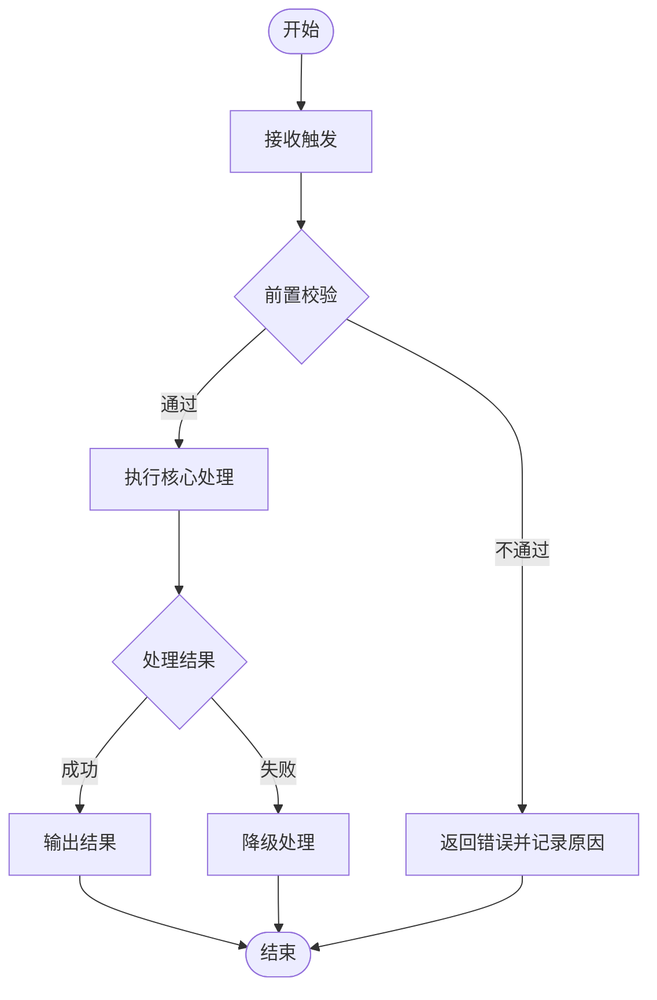

# PRD 编写通用约定（共用层）

本文件被方向 S 与方向 A 两套模板同时引用。**禁止**把本文件正文复制进 `references/software-system/` 或 `references/agent-system/`；特化层只写差异，并注明「其余遵循 `references/shared/conventions.md`」。

---

## 1. 占位符双轨制（强制）

本技能产出**两份文档**，占位符规则按文档分流。两类写法**不得混用**。

| 文档 | 未决信息写法 | 是否允许 `[待补充：…]` |
| :--- | :--- | :--- |
| **PRD 正文** | 中性表述或省略（见 §1.1） | **禁止** |
| **补充说明文档** | `[待补充：{信息项}]` | **必须使用** |

### 1.1 正文的中性表述（三选一）

| 情形 | 写法 | 示例 |
| :--- | :--- | :--- |
| 取值可由配置提供 | 「以配置提供」「由部署配置提供」 | 「历史同类故障条数由配置定义」 |
| 取值需由外部方约定 | 「按 X 约定」「按 X 确定」 | 「按依赖提供方约定」「按部署环境确定」 |
| 信息本身尚未确定，且无法用上述表述 | **省略该信息**，只写已确定部分 | 写「编号（唯一标识）」，不写「编号（生成规则：…）」 |

**约束**：中性表述只能说明**取值来源**，不得暗示具体取值。写「由部署配置提供」合规，写「一般设为 5 条」违规。

### 1.2 槽位与占位符的区分

| 类型 | 写法 | 含义 | 处理方式 |
| :--- | :--- | :--- | :--- |
| **结构槽位** | `[功能名称]` `[状态一]` `[字段]` `[阈值]` | 文档结构要求的必填栏目 | **必须**依据上下文写出真实内容，不留空。正文与补充说明均适用 |
| **待补充占位符** | `[待补充：{信息项}]` | 只能由用户 / 业务方提供的信息 | **只允许出现在补充说明文档**，禁止代为填写 |

判定标准：该信息是否只能由用户给出？
- 是 → 补充说明中用占位符；正文中用中性表述或省略
- 否（可从已有上下文明确推导）→ 槽位，直接填写

### 1.3 统一格式（仅补充说明文档）

```
[待补充：{信息项}]
```

(1) `{信息项}` 必须是**具体名词短语**，说明「要什么」，如 `[待补充：心跳超时阈值]`；不得简写为 `[待补充]`。

(2) 表格单元格缺内容 → 该单元格填 `[待补充：{信息项}]`。

(3) 整节内容缺失 → 在该节标题下独立一行写 `[待补充：{信息项} — 需用户确认]`。

(4) 全篇只允许这一种写法，不区分中英文、全半角。

### 1.4 硬性禁令

以下写法在**任何文档中**均禁止，出现即视为不合格：

| 禁止写法 | 说明 |
| :--- | :--- |
| `待定` / `TBD` / `TODO` / `待确认` / `视情况而定` / `后续补充` | 变体占位符（正文与补充说明均禁止） |
| `[待补充]`（无信息项） | 格式不完整 |
| `建议默认值：X` / `暂定 X` / `一般为 X` / `行业惯例是 X` | 变相编造 |
| 示例值 / 假想值（`张三`、`example.com`、`/path/to/xxx`） | 编造内容 |
| 正文中的 `[待补充：…]` | 正文禁止未决标记 |

以下内容**禁止推断填充**：路径、目录、文件名、项目名、人名、团队名、账号、密钥、URL、端口号、阈值、日期、金额、工期、负责人、成本。

### 1.5 待确认清单

正文**不附**待确认清单。全部待确认事项登记于补充说明 §3，结构见 `companion-doc.md` §4。其中 §3.3「正文留空位置对照」必须与正文逐条对应，不得遗漏。

---

## 2. 语言与表达规则

(1) 正文、表格、示例、输出模板、页面文案默认使用**中文**；用户明确要求其他语言时整篇统一切换，禁止中英混排。

(2) 专有名词保留英文原文：API 名、字段名、状态码、协议名、技术术语（`device_uuid`、`HTTP 502`、`MCP`）。

(3) 需求条目只写**结论**，不写推导过程、背景铺陈与修饰语。

(4) 禁止模糊词：`高效`、`便捷`、`智能`、`稳定`、`良好`、`显著提升`、`尽量`、`尽快`、`尽可能`。

(5) 禁止无度量意义的宣传式表述；每个形容词要么换成可量化口径，要么删除。

(6) 数值必须带单位与口径（`P95 < 30s`、`≤ 20 条/分钟`、`在线保留 90 天`），禁止裸数字。

---

## 3. 编号体例（全篇统一）

(1) **章节编号**：`一、` → `1.1` → `1.1.1`，最多三级。

(2) **列表编号**：主项用 `(1) (2) (3)`，子项用 `①②③`，再下一层用 `a. b. c.`。

(3) **业务编号列**：`C1…Cn`（硬约束）、`P0/P1/P2`（优先级）、`T-1…T-n`（业务决策项）、`N-1…N-n`（技术确定项）、`G1…G10`（门禁）。

(4) 禁止同一文档内出现两套并行编号体系。

---

## 4. 排版与组织规则

| # | 规则 | 说明 |
| :--- | :--- | :--- |
| **R1** | 按阅读逻辑组织，不按文档类型拆章 | 同属一条处理链路的「输入 → 判定 → 排序 → 异常」必须合为一章按链路顺序写，禁止拆成「数据」「规则」「异常」三个独立章节来回翻 |
| **R2** | 前端展示合为一章 | 「用户看到什么」相关内容统一一章，按「在哪看到 → 长什么样 → 放什么 → 各场景放什么 → 示例」组织 |
| **R3** | 多场景逻辑按流程写 | 不同场景处理逻辑不同时，按「先判走哪条路 → 每条路怎么走」写，禁止把判定 / 排序 / 去重拆成平行表让读者自己拼 |
| **R4** | 过滤与边界规则必须标注适用场景 | 逐条标明生效场景与不适用场景，用对比表最清晰；禁止笼统一张表 |
| **R5** | 涉及计算必须写完整公式 | 分值、阈值判定、贡献度、成功率等必须写出含分子分母与运算符的完整公式；禁止用「变化率」「贡献度」等自造词代替 |
| **R6** | 同类公式横向一致性 | 多个分组 / 场景各有一套公式时，横向核对维度是否对齐，有遗漏维度主动指出 |
| **R7** | 参数不重复列 | 阈值等参数已在具体逻辑中写清时，不再单独出一张「参数汇总表」重复列一遍，避免两处不一致 |
| **R8** | 流程复杂必须出流程图 | 存在条件分支、多角色交接、循环重试、状态机的，必须用 Mermaid；线性无分支流程用模块划分说清即可，不画图 |
| **R9** | AI / 模型参与产出必须划边界 | 必须明确：① 固定部分（代码控制，模型不可改）② 自由发挥部分（交给模型生成）③ 约束清单（模型不可以做什么）④ 提示词模板（含占位符）⑤ 校验方法 |
| **R10** | 图表优先 | 能用表格 / 图示表达的不要写段落；表格列宽以「一屏可读」为准，超宽表拆为两表；图片横向排布精简篇幅 |
| **R11** | 正文净化 | 正文只承载需求本体；杂项信息一律外移，见 §7 |

---

## 5. 流程图与状态表达规范

(1) 统一使用 **Mermaid**，禁止 ASCII 字符画流程图。

(2) 每个流程必须包含：开始节点、正常路径、**至少 1 条异常路径**、结束节点。

(3) 分支必须标注条件；节点文案使用动宾短语（`写检查项明细`，不写 `检查项明细写入`）。

(4) 涉及跨角色时序的用 `sequenceDiagram`；涉及状态流转的用**状态表**（不用状态图，状态表更利于逐格核对）。



---

## 6. 两文档形态

### 6.1 PRD 正文

(1) 首行为文档标题，其后直接进入第一章。

(2) **不得出现**元信息行、版本号、日期、作者、名词解释、需求背景、目标用户、成功标准、待确认清单、篇幅说明、配套索引。

(3) 正文只保留：范围与边界、能力 / 功能规约、全局机制、依赖与数据、指标与可观测性、验收标准。

### 6.2 补充说明文档

结构见 `companion-doc.md`。六节：文档信息 / 需求背景 / 待确认事项清单 / 版本变更说明 / 非核心需求细则 / 配套文档索引。

### 6.3 命名与标题

| 文档 | 文件名 | 文档标题（首行） |
| :--- | :--- | :--- |
| 正文 | `[产品名称] 产品需求文档（PRD）[版本或日期后缀].md` | `# [产品名称] 产品需求文档（PRD）` |
| 补充说明 | `[产品名称] 产品需求文档（PRD）[版本或日期后缀] — 补充说明文档.md` | `# [产品名称] 产品需求文档（PRD）— 补充说明文档` |

**正文标题不携带版本号、日期与变体标记**（如「精简版」「V2」「终版」）。多版本靠文件名后缀区分，正文内部保持同一形态。

两文档**同目录存放、同时交付**。

---

## 7. 正文净化机制

**PRD 正文只承载需求本体。** 这是本技能的核心约定。

### 7.1 归属原则

| 内容 | 归属 | 原因 |
| :--- | :--- | :--- |
| 范围、能力 / 功能、规则、约束、接口、数据、指标、验收 | 正文 | 开发与测试的唯一执行依据 |
| 版本号、变更记录、变更明细、篇幅对照 | 补充说明 §4 | 正文不应出现版本痕迹 |
| 名词解释、角色与读者、章节对应 | 补充说明 §1 | 阅读辅助信息，非需求 |
| 需求背景、痛点、目标用户、需求目标、成功标准 | 补充说明 §2 | 立项语境，非需求本体 |
| 待定事项、决策项、正文留空位置对照 | 补充说明 §3 | 正文不留任何未决痕迹 |
| 界面与文案规范、配置字段校验、容量估算、附加功能候选 | 补充说明 §5 | 非核心细则 |
| 配套文档清单 | 补充说明 §6 | 索引信息 |

### 7.2 需求指针

正文允许保留指向补充说明的**需求指针**（如「渠道配置字段与校验规则见《补充说明文档》」），但**不得**出现指向补充说明的杂项索引（如「本文档背景见《补充说明文档》」）。

### 7.3 双向同步

| 触发 | 同步动作 |
| :--- | :--- |
| 正文新增中性表述或省略项 | 补进补充说明 §3.3 正文留空位置对照 |
| 补充说明新增决策结论 | 检查正文对应位置的中性表述是否应改为确定表述 |
| 正文结构调整 | 同步更新补充说明 §1.3 章节对应 |
| 任一份文档改版 | 同步更新补充说明 §4 版本记录与变更明细 |

---

## 8. 交付形态

(1) 默认在对话中输出 Markdown。**正文与补充说明分两段或分两文件输出**，不合并为一份。

(2) 用户要求可下载文件或 `.docx` 时，导出前确认 `[待补充：目标文件格式]` 与 `[待补充：输出目录]`（此类确认属过程交互，不受正文净化约束）。

(3) 分段生成长文档时，每段结束均需附带该段的待确认清单。

(4) 定稿前执行清单：

```
① 通用门禁 G1–G10 全通过
② 特化方向私有门禁全通过
③ 补充说明私有自检 6 项全通过
④ 正文杂项泄漏为零（scripts/validate.py 扫描）
⑤ 补充说明 §3.3 与正文中性表述逐条对应
⑥ 所有 Mermaid 图可正常渲染
⑦ 所有公式含分子分母与运算符
```
