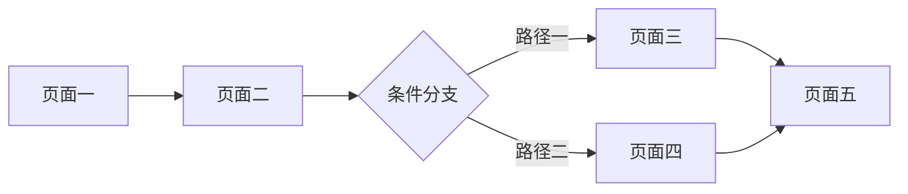

# 页面结构规范（方向 S · 通用软件 / 系统 私有层）

本文件定义方向 S 落地版 PRD「三、信息架构与页面结构」章节的三张表。方向 A 不使用本文件，其轻量界面草图见 `../agent-system/template.md` §9。

**设计原则：先定页面，再列功能。** 每个 P0/P1 功能都必须映射到至少一个页面，禁止出现「只列功能不列页面」的 PRD。

---

## 1. 导航结构表

| 导航层级 | 页面名称 | 页面定位 | 入口 | 主要承载功能 |
| :--- | :--- | :--- | :--- | :--- |
| 一级 | [页面名称] | [在整体中的定位] | 默认打开 / 底部 Tab / 侧边导航 / 顶部导航 | [承载的功能] |
| 二级 | [页面名称] | [查看或编辑具体对象] | [从哪个页面、什么操作进入] | [承载的功能] |

- 一级页面不超过 5 个
- 「入口」必须写明**具体触发位置**，禁止写「从首页进入」这类无定位信息的表述
- 层级取值：一级 / 二级 / 弹窗 / 抽屉

---

## 2. 页面职责说明表

| 页面名称 | 用户目标 | 关键内容 / 组件 | 空状态 | 异常状态 |
| :--- | :--- | :--- | :--- | :--- |
| [页面] | [用户进入此页要完成什么，动宾短语] | [列表 / 表单 / 日历 / 图表 / 按钮等] | [无数据时显示什么] | [加载失败 / 权限不足等表现] |

- **每个页面都必须填写空状态与异常状态**，不允许留空
- 「用户目标」一页只写一件事

---

## 3. 页面与功能映射表

| 功能名称 | 入口页面 | 过程页面 | 结果展示页面 |
| :--- | :--- | :--- | :--- |
| [功能] | [页面] | [页面 / 弹窗 / 抽屉 / 无] | [页面] |

- 功能列表中的每个 P0/P1 功能在此表必须有且仅有一行
- 「过程页面」为「无」时表示在当前页完成
- 出现某个功能无对应页面时，返回第 1 节补充页面，**禁止绕过**

---

## 4. 导航模式选择

| 模式 | 适用场景 | 约束 |
| :--- | :--- | :--- |
| 底部 Tab | 一级页面 3–5 个，需频繁切换 | Tab 数量 ≤ 5，切换不丢失页面状态 |
| 侧边导航 | 一级页面 > 5 个，或层级深 | 桌面端 / 大屏优先 |
| 顶部导航 | 一级页面 2–4 个的同级内容 | 移动端需考虑宽度限制 |
| 单页流程 | 单一线性任务 | 需提供中断恢复机制 |
| 向导 | 多步表单、配置类任务 | 需提供返回上一步与草稿保存 |

在 PRD 中需写明：**本产品选用哪种模式，为什么**。

---

## 5. 页面流转图（按需）

存在多页面跳转分支时，用 Mermaid 表达：

---

## 6. 私有自检（页面结构专项）

本节只列**方向 S 私有门禁之外的增量项**。以下两项已由 `template.md` 末尾「私有自检（方向 S 增量 8 项）」覆盖，不在此重复：

- 每个 P0/P1 功能都出现在「页面与功能映射表」中 → 见该自检第 1 项
- 每个页面都填写了空状态与异常状态 → 见该自检第 2 项

本文件追加检查：

- [ ] 一级页面数量 ≤ 5，导航模式选择有明确理由
- [ ] 每个二级页面的入口写明具体触发位置，无「从首页进入」这类无定位信息表述
- [ ] 「页面与功能映射表」中无「过程页面」缺失却未标注「无」的行
